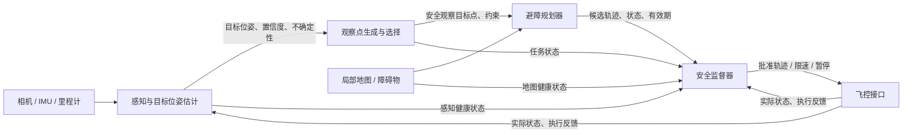

下面按**静止装甲板的非接触式识别、定点观察或巡检**来梳理。核心原则是：**感知只报告“看到了什么”，观察点模块提出“去哪里看”，规划器生成无碰撞轨迹，安全监督层拥有最终否决权。**不要让视觉跟踪器直接输出飞控速度，也不要让多个模块同时争夺轨迹控制权。

## 1. 感知：输出目标信息，不直接控制飞行

感知模块负责从图像中检测板面图案，并估计板面的**位置、朝向和可信度**。它不决定无人机该如何接近，也不直接发布速度或姿态指令。

建议输出的字段：

| 字段 | 含义 |
|---|---|
| `header.stamp` | 采集图像的时间戳 |
| `frame_id` | 位姿所在坐标系，例如相机坐标系或机体坐标系 |
| `target_id` | 目标标识；无法稳定识别时应标为未知 |
| `pose` | 目标位置与朝向 |
| `covariance` 或质量指标 | 位姿估计的不确定性 |
| `confidence` | 检测置信度 |
| `valid`、`tracking_state` | 当前结果是否有效、跟踪是否稳定 |
| `source_image_id` | 便于日志回溯的图像或帧编号 |

**关键约定：**

- 明确使用哪种坐标系、轴方向、单位和时间基准；例如统一采用 ENU 或 NED，不能混用。
- 相机坐标到机体坐标、机体坐标到世界坐标的变换必须有时间戳，避免用旧变换处理新图像。
- 目标位姿必须带不确定性。低置信度、遮挡、目标丢失或估计跳变时，要报告状态，而不是输出看似精确的坐标。
- 目标观测与障碍物地图是不同信息：检测到板面不代表板面周围空间可通行。

## 2. 观察点生成：把“看目标”转换成安全目标位姿

这一层接收目标位姿，生成一个或多个**非接触观察位姿候选**。候选点应位于目标前方的安全区域，并考虑相机视场、机体尺寸、定位误差和周边障碍物。

观察点输出可包括：

- `goal_pose`：期望的观察位置与机头朝向；
- `standoff_distance`：与目标保持的安全间距；
- `view_constraints`：目标在相机视野中的期望范围；
- `valid_until`：该观察点的有效期限；
- `reason/status`：候选点生成成功、空间受限、目标估计不可靠等状态。

**职责边界：**

- 观察点模块只产生候选目标，不生成电机、姿态或速度命令。
- 若目标姿态不确定，应生成更保守的观察目标，或暂缓更新；不要因为检测结果短暂跳动而让目标点来回摆动。
- 如果目标周边没有满足安全距离和可观测性要求的观察位置，应报告“无安全观察点”，而不是把目标表面当作飞行终点。
- 可以设置观察点滞回：新候选点只有在明显优于当前目标且持续稳定时才替换，减少频繁改点。

## 3. 避障规划：唯一负责生成飞行轨迹的模块

规划器接收当前无人机状态、地图和观察点，生成满足动力学与避障约束的轨迹。它负责回答“是否存在安全、可执行的路径”，而不是判断“目标是否值得接近”。

规划输入通常包括：

- 当前位姿、速度及其时间戳；
- 局部障碍物地图及地图有效状态；
- 观察点及其有效期；
- 无人机的运动约束和安全边界；
- 任务模式，例如“前往观察点”或“悬停观察”。

规划输出应包含：

- 带时间信息的轨迹或轨迹段；
- 轨迹有效期、规划状态和失败原因；
- 轨迹所依赖的地图版本或环境时间戳；
- 是否需要停车、悬停或重新规划。

**接口原则：**

- 观察点是规划目标，不是必须到达的命令；规划器有权报告“不可达”或“有碰撞风险”。
- 规划器是轨迹的唯一生产者。视觉跟踪模块、观察点模块不应并行发布另一套速度指令。
- 地图过期、目标点过期、规划超时或轨迹不可行时，规划器应明确报告异常状态，不能默默沿用一条已失效的轨迹。
- 目标板及其附近区域应作为需保持间距的障碍/禁入边界处理；只在安全观察点上结束轨迹。

## 4. 安全监督：独立检查、限制或拒绝执行

安全监督器不替代规划器，而是对轨迹、状态和系统健康状况做独立检查。它有权批准、限速、暂停或触发安全模式。

至少检查：

- 目标与地图是否仍然有效，时间戳是否新鲜；
- 轨迹是否符合速度、加速度、爬升率、飞行区域和安全间距限制；
- 无人机当前状态是否偏离轨迹过多；
- 定位、通信、电量、传感器和飞控是否正常；
- 是否出现突然改点、规划失败、目标丢失或地图异常。

建议定义统一的执行状态，例如：

| 状态 | 行为 |
|---|---|
| `NORMAL` | 执行已批准的观察轨迹 |
| `LIMITED` | 降低速度或缩小动作范围 |
| `HOLD` | 悬停或保持安全位置，等待有效输入 |
| `RETURN` | 按预设安全策略返航 |
| `LAND` | 在条件允许时进入安全降落流程 |

具体切换条件应由系统风险分析确定。安全模式要由独立的状态机管理，并在仿真和受控测试中验证。

## 5. 建议的模块契约

可以把接口约定浓缩成以下规则：

1. **所有消息带时间戳和坐标系。**
2. **感知输出目标状态与不确定性，不输出飞行命令。**
3. **观察点模块输出安全候选目标，不输出轨迹。**
4. **规划器是唯一的轨迹生成者，并可拒绝不可行目标。**
5. **安全监督器可以拒绝任何轨迹；它失效时不能默认继续执行。**
6. **每个输出都有有效期，超时后进入预定安全状态。**
7. **目标丢失、位姿突变、地图失效或规划失败时，优先保持安全间距并悬停/退出任务。**

## 6. 验证顺序

建议先在仿真中分别验证各模块，再做端到端联调：

1. 用固定目标和已知位姿检查坐标变换、朝向定义和时间戳。
2. 验证观察点生成不会落到目标表面、障碍物内部或飞行边界之外。
3. 单独测试规划器在观察点可达、不可达、地图变化等情况下的状态反馈。
4. 注入目标丢失、低置信度、定位漂移、通信中断和规划超时，检查安全状态转换。
5. 在封闭、无危险载荷的环境中验证定点观察、悬停和人工接管。

这样分层后，感知误差或规划器重规划不会直接变成突发的飞行动作；目标识别的结果只影响**安全观察目标**，最终轨迹仍由规划器生成并由安全监督器把关。